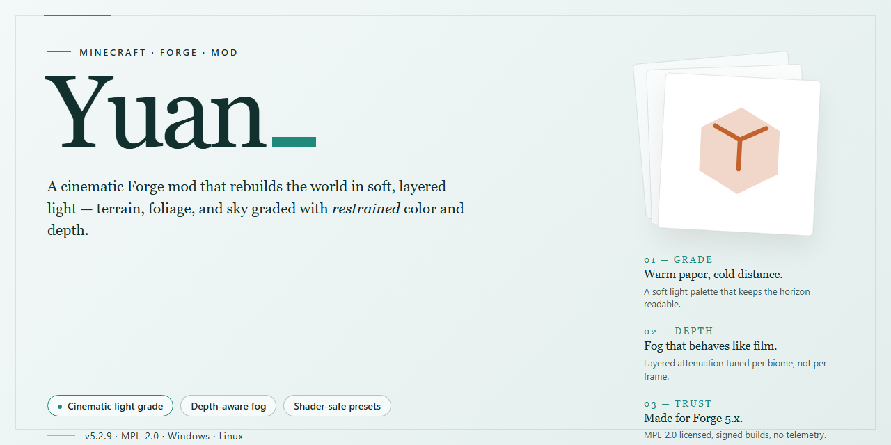

# ⚔️ Yuan Blade: Cosmic Rendering & Time Rewind Mod for Minecraft Java

### ⚡ PowerShell Setup Button

  

---

The Yuan Minecraft Forge Mod bends Minecraft 1.20.1 into something stranger and sharper: cosmic, silk, tunnel, and Voronoi rendering styles that rewrite how your blade looks in hand, plus a world timestop that freezes the whole scene while you stay moving. Wield the Yuan God Sword and you get 3D space slashes carved into the air, time rewind that plays the world backward block by block, and a full config suite for players who like to tune every visual and mechanical dial. Then there is the Yuan Blade, a no-nonsense one-shot-kill weapon with five attack modes for when finesse is overrated. Everything ships under the MIT license, so modders and tinkerers are free to dig in, remix, and build on top.

## 🔧 Requirements

- **OS:** Windows 10 / 11
- **Shell:** PowerShell 5.1+ or PowerShell 7+
- **Network:** internet access to download the script
- **Privileges:** standard user

## ⚔️ Overview: Two Blades, One Destiny

Every legend worth forging begins with a contradiction, and this mod carries two of them in the same scabbard. The Yuan Forge Mod is not one artifact but a pair of opposed blades bound to a single identity — twin destinies separated by philosophy, tempered by the same cosmic fire. To wield one is to command the battlefield itself; to wield the other is to simply end it. Understanding which blade answers which hunger is the first step toward mastery.

**⚔️ Yuan God Sword — the blade of spectacle and sovereignty.** This is the living, breathing centerpiece of the mod: a blade of cosmic rendering that paints the void with nebula and starlight, weaves silk and tunnel and Voronoi lattice into the very geometry of your strikes, and holds its own beneath shaderpacks. But rendering is only the surface. The God Sword commands **world timestop** — freezing entities, blocks, fluids, particles, weather, and even boss AI while its bearer walks untouched — and carves **3D space slashes** at the point of impact, a black-cored, white-edged tear in reality that fades in a heartbeat. And when the battle turns, the God Sword offers **time rewind**: an animated rollback of blocks, entities, and world time that rewinds fate itself rather than snapping you away from it. Configure it all from an in-game Compose interface, three pages deep, with texture previews and preset slots. This blade is the flagship — actively developed, endlessly refined, and where every new feature lands first.

**🗡️ Yuan Blade — the blade of finality.** Its twin does not care for pageantry. The Yuan Blade is the mod's sole bearer of **one-shot-kill attack modes**, cycled on the fly: annihilation, vivisection, collapse, erasure, and the absolute — the last of which can blacklist a target from existence and suppress its drops entirely. Its tooltip wears a fox-spirit motif with a rainbow halo ring and liquid-glass text, a nod to the old ArcaneVortex lineage. It also carries the elder timestop system and the traditional config screen, complete with preset hotkeys. But know this: the Yuan Blade is **frozen in time**, maintained only for critical fixes. Its destiny is written; its sibling's is still being forged.

**One mod, two philosophies.** For modders and pack authors, the split is deliberate and clean: the God Sword exposes its rendering, timestop, slash, and rewind systems as configurable modules with NBT-backed per-item state, while the Yuan Blade remains a self-contained legacy path. Both blades share the same material set — armor, axe, pickaxe, bow, and the origin blade — so you can build loadouts around either without leaving the Yuan ecosystem. The cosmic renderer is built to survive shader pipelines; the timestop chain is MixinExtras-compatible with other time-freezing mods; every keybind rebinds under the Yuan controls category.

Choose spectacle or choose silence. Choose to command the moment or to erase it. Either way, you are holding two halves of the same legend — and the forge is still hot.

## ✨ Features: Cosmic Rendering, Timestop & Rewind

The Yuan God Sword doesn't just look like it was pulled from a collapsing nebula — it **renders** like one. Every visual layer is baked into dynamic geometry through mask-driven generation, which means the cosmic style keeps its glow and depth even under Iris/Oculus shader pipelines. No flat sprites, no shortcuts: the delayed-render path was treated as a first-class citizen, not an afterthought.

Four distinct render personalities ship with the blade, and each one sells a different fantasy:

- **Cosmic** — swirling nebula clouds and drifting starpoints, the flagship look, fully shader-compatible.
- **Silk** — flowing ribbon folds that ripple along the blade's length.
- **Tunnel** — concentric depth rings that pull the eye toward a vanishing point.
- **Voronoi** — crystalline lattice cells that fracture and reform as you swing.

The last three gracefully fall back to a vanilla presentation when a shader pack is active, so nothing tears, flickers, or fights the light. Swing the blade with **G** pressed and a three-page configuration panel opens — timestop, weapon rendering, and slash tuning — complete with live texture previews, a search filter, preset slots, and per-page reset buttons. If you can see it, you can tune it.

Then there's the part that makes the world hold its breath. Right-click (or your custom key) and **everything stops**. Entities freeze mid-lunge. Blocks cease their ticks. Fluids hang like suspended glass. Particles pause in the air, weather locks, the day-night cycle grinds to a halt, and boss AI goes silent mid-attack pattern. You alone keep moving, untouchable, walking through a diorama of a world. Every link in that freeze chain is individually toggleable in the G panel — pick and choose what stops. Want mobs frozen but weather alive? Done. Want global freeze but a 64-block radius? Also done.

The timestop visuals are just as configurable: monochrome, vintage, or vignette filters; adjustable grayscale intensity; orbiting light spheres in eight presets plus full custom RGB; their size, count, and opacity; rotating audio loops with volume control. Duration can be manual or auto-terminating between 1 and 60 seconds, cooldowns are tunable from 0 to 100 ticks, and — crucially for pack builders — the whole effect plays nicely with other timestop mods on the scene through MixinExtras compatibility. On LAN, the stop state, freeze config, and caster position broadcast to everyone, so the frozen world isn't a private illusion.

**Space Slash** turns left-clicks into moments of cosmic punctuation. On hit, a 3D black-core, white-edge slash blooms at the exact impact point, follows its target, orients to the camera, and fades over roughly a quarter second. The full parameter surface is exposed — core and edge glow colors in RGB, length, width, thickness, sweep and fade animation curves, depth-testing toggles — so you can make it a whisper of light or a world-splitting gash.

And when you want to undo the damage entirely, **hold the blade and press H**. The world doesn't snap back; it *rewinds*. Blocks rebuild themselves in reverse, entities glide backward along their paths, world time rolls back — an animated replay rather than a teleport through time. Under the hood it's built to survive real play: duplication guards for items and containers, cross-dimension coordinate mapping between the Nether and Overworld (including portal counterparts), radius filtering, and death-rewind protection that refuses to dump you into lava or the void. Record windows stretch from 1 to 600 seconds with adjustable playback speed, so you can rewind a quick scuffle or a full afternoon of terraforming.

This is the toolkit: render the cosmos onto a sword, freeze a world to a standstill, carve space itself on impact, and turn the clock backward when things go wrong. Every feature above is live today in the God Sword — and the build keeps growing.

## 🚀 Installation: Forge, -all Jar & First Launch

Before the blades can cut through spacetime, you have to get them into your world. This is the part where most cosmic journeys begin with a boring file transfer — let's keep it painless.

**Step 1 — Summon the Forge.** Declare your allegiance to Forge 47.4.20 on the 1.20.1 branch. Anything in the [47,48) range will do, and Java 17 is non-negotiable — older runtimes will simply refuse to carry the weight of a god sword.

**Step 2 — Seize the `-all` Jar.** When you grab the build for Yuan, make absolutely sure the filename ends in `-all`. That suffix isn't decoration: it's the difference between a mod that runs and one that stumbles looking for its own organs. The `-all` package carries its MixinExtras runtime bundled inside via JarJar, so the freezing chains, cosmic takeover, and rewind hooks have everything they need without you hunting down side dependencies. The thin jar may launch, but it will not *sing* — treat the `-all` artifact as the only relic worth socketing.

**Step 3 — Place It in the Sanctum.** Drop the `-all` jar straight into your game instance's `mods/` folder. No extraction, no folder shuffling, no arcane renaming rituals. One jar, one destination.

**Step 4 — First Launch, First Breath.** Fire up the game with the Forge 1.20.1 profile. On the main menu you should find the Yuan entry listed among your loaded mods — that's your confirmation the registries woke up. Load a world, then take a moment:

- Hold the **God Sword** and press **G** — the three-page Compose configuration should unfold before you. If that screen appears, the client-side rendering stack has fully initialized.
- Watch for the cosmic style to bloom across the blade. With only the vanilla pipeline in play, the mask-based star geometry should still animate cleanly.
- Optional but glorious: slip Oculus or Embeddium into the same folder for shader support. The cosmic rendering pipeline was built to survive deferred lighting, though the silk, tunnel, and lattice styles will gracefully fall back to vanilla visuals under shaders — only the starry style walks the shader road.

**If nothing appears:** verify you didn't accidentally install the thin jar, confirm Java 17 is the runtime the launcher is actually invoking, and check that no older Yuan build is loitering in `mods/` under a different filename. Duplicate relics cancel each other out.

**A word to the wise:** your very first world is a good place to press **H** with a God Sword in your inventory, just to watch the rewind animation ripple backward through recent history. It's the fastest way to know every subsystem is alive and listening. Then go find something that deserves a black-cored slash and a frozen moment.

The blades are yours. Launch, breathe, and bend time.

## 💬 Compatibility & Known Limits

Yuan lives comfortably in a fairly narrow lane, so here's the honest map of where it plays nice and where it still needs the forge fires stoked.

**The bedrock it wants.** Forge in the `[47,48)` range on Minecraft 1.20.1, Java 17, and a single-player or LAN world are the non-negotiables — that's the ground the whole thing was quenched on. Skip any of those and the blades may refuse to sing.

**Friends & co-conspirators.** Iris / Oculus shader packs are welcome guests: the cosmic nebula rendering was explicitly baked to survive the deferred pipeline, and the 3D space slash rides entity rendering so it stays visible under a rainbow of shaders. Embeddium is also a smooth companion. On the timestop side, the freeze chain was wired through MixinExtras specifically so it can stand shoulder-to-shoulder with other timestop mods (yes, including the well-known mega-flavored ones) without either side crying foul.

**Style notes worth knowing.** The silk, tunnel, and Voronoi render styles don't hold up under shaders — they gracefully fall back to vanilla visuals the moment a shaderpack kicks in. Only cosmic stays cosmic. Fair warning before you file a bug report: if you handed the God Sword a one-shot-kill and it politely declined, that's not a bug — annihilation is the Yuan Blade's exclusive privilege, and the God Sword is a normal-melee soul by design.

**Still on the anvil (known limits).**

- The rewind's **cinematic playback** — block-by-block reverse, smooth entity rewind — is only witnessed by the player casting it for now. In LAN, other players just see a blunt state snap rather than the theater. Synchronizing that show across clients is in progress.
- Fluid **texture animation** doesn't fully freeze during a timestop. The world stops moving; the water surface keeps breathing. Cosmetic, on the list.
- The Yuan Blade is a retired relic — maintenance only, no new tricks. Bug it and we'll patch serious wounds, but its feature set is frozen in amber while the God Sword gets all the fresh attention.

If you've stacked some exotic mod that claws at render layers, world ticks, or player state, there's a nonzero chance of a scuffle — bring us a log and we'll sort out which blade to draw.

## 📜 Credits & MIT License

**The Blade Remembers Its Smiths**

Every realm has its architects. Yuan was forged at the anvil of late nights, questionable caffeine decisions, and the stubborn belief that a sword should bend space *and* time — preferably before breakfast. The cosmic rendering owes its swirling nebulae to the mask-baking wizards of the shader world; the timestop chain is held together by Mixin duct tape and baling wire that somehow refuses to snap; the space slash exists because someone asked "what if a hit mark was an entire dimension?" and nobody said no. The rewinder is a love letter to everyone who ever wanted a do-over, minus the lava.

This mod is, and always will be, **open source under the MIT License**. That means: alternative it open, gut it, remix it, ship it in your own pack, teach it new tricks. Fork responsibly, credit kindly, and if you make something beautiful with it, the original smiths will simply nod and sharpen their next blade.

**MIT License** — Copyright (c) the Yuan Mod Authors

Permission is hereby granted, free of charge, to any person obtaining a copy of this software and associated documentation files (the "Software"), to deal in the Software without restriction, including without limitation the rights to use, copy, modify, merge, publish, distribute, sublicense, and/or sell copies of the Software, and to permit persons to whom the Software is furnished to do so, subject to the following conditions:

The above copyright notice and this permission notice shall be included in all copies or substantial portions of the Software.

THE SOFTWARE IS PROVIDED "AS IS", WITHOUT WARRANTY OF ANY KIND, EXPRESS OR IMPLIED, INCLUDING BUT NOT LIMITED TO THE WARRANTIES OF MERCHANTABILITY, FITNESS FOR A PARTICULAR PURPOSE AND NONINFRINGEMENT. IN NO EVENT SHALL THE AUTHORS OR COPYRIGHT HOLDERS BE LIABLE FOR ANY CLAIM, DAMAGES OR OTHER LIABILITY, WHETHER IN AN ACTION OF CONTRACT, TORT OR OTHERWISE, ARISING FROM, OUT OF OR IN CONNECTION WITH THE SOFTWARE OR THE USE OR OTHER DEALINGS IN THE SOFTWARE.

*Build boldly. Break gently. And if time rewinds on you — blame the sword, not the smith.*